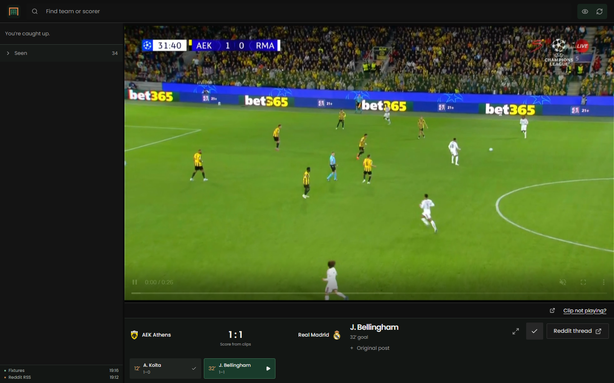

# Touchline

A focused r/soccer goal hub: open it, browse the latest available clips, and watch. Built with .NET 10, React, TypeScript and SQLite.



Read the [project case study](docs/case-study.md) for the UX decisions, implementation and verified limits.

## Run locally

Requirements: .NET 10 SDK, Node.js 22.14+ and npm.

```powershell
./scripts/start.ps1
```

Open `http://127.0.0.1:5195`. The script installs frontend dependencies when needed, builds the frontend and serves the complete app from ASP.NET Core. If the SDK is outside PATH, pass `-DotNet /path/to/dotnet` or set `DOTNET_ROOT`.

For development, run `dotnet run --project src/Touchline.Api` and `npm --prefix web run dev` in separate terminals. The Vite UI is at `http://127.0.0.1:5194` and proxies `/api` to the .NET host.

## What works without keys

- Browse every available r/soccer goal in the fetched feed, without choosing clubs or fixtures.
- Check individual Reddit and fixture source states and last fetch times from the bottom-left connection panel.
- Search by team, alias or scorer. Old favourite and match URL parameters cannot filter the hub.
- Play supported clips muted, with source recovery and alternate links. Reselecting the active goal preserves playback.
- Mark goals seen immediately when opened; expand Seen inside the goal list to revisit viewing history, or mark one unwatched again.
- Hide scores and scorers until you reveal a goal.
- See club crests alongside goal details, with fallback formats and initials for unavailable images.
- Explore fictional goal metadata using `?sample=true`. Sample mode supplies no footage and stores viewing preferences separately in the browser.

The goal hub does not require fixture access. Optional provider metadata can use a football-data key. Reddit discovery uses public RSS by default until its announced retirement on 13 November 2026; OAuth requires approved access. Missing connections never silently substitute sample data. Real fixtures, public goal discovery and Streamin/Streamain playback were verified on 4 November 2026.

## Optional provider metadata

Register at [football-data.org](https://www.football-data.org/client/register). Once your key is issued, run `./scripts/configure-provider.ps1` in PowerShell 7. The prompt masks your key and sends it to .NET user secrets through stdin, avoiding command history and process arguments. Restart the backend afterwards. Pass `-DotNet /path/to/dotnet` if the SDK is outside PATH.

For an alternative manual setup, configure .NET user secrets from this project directory:

```powershell
dotnet user-secrets set 'FootballData:Token' '<your-key>' --project src/Touchline.Api
```

Restart the backend, then open Sources. Free-plan scores are delayed, and available competitions depend on the plan. Today’s fixture window refreshes at most every 30 seconds; other dates are cached for five minutes. A shared ceiling of six fixture requests per minute applies across all tabs and dates. There is no claim of instant livescores.

## Connect Reddit only if your app is approved

A Reddit login is not proof of Data API approval. Reddit announced that new public API access requests stopped on October 31, 2026, and remaining public API access ends in March 2027. Verify your existing app's access before enabling this integration. [Official announcement](https://www.reddit.com/r/redditdev/comments/1wubcvf/moving_data_api_apps_to_the_developer_platform/).

For an already approved confidential app supporting application-only OAuth:

```powershell
dotnet user-secrets set 'Reddit:ClientId' '<approved-client-id>' --project src/Touchline.Api
dotnet user-secrets set 'Reddit:ClientSecret' '<client-secret>' --project src/Touchline.Api
dotnet user-secrets set 'Reddit:UserAgent' 'Touchline/0.1 by /u/your-account' --project src/Touchline.Api
dotnet user-secrets set 'Reddit:Enabled' 'true' --project src/Touchline.Api
```

Alternatively, set `Reddit:AccessToken` to an existing approved OAuth token. Such tokens expire; replace it when the provider refuses access. The client-credentials flow refreshes its application token automatically. Restart after settings change. Environment variables use double underscores, such as `FootballData__Token` and `Reddit__Enabled`.

Keys remain on the server and are never returned to the browser. No credential form writes secrets to source files. Do not commit keys or copy them into a chat.

The approved OAuth reader paginates the r/soccer new listing toward the 48-hour boundary, with a ten-page safety budget per scan. Unknown club names are accepted. The source status reports partial coverage when the listing ends before the time window can be established. Removed/NSFW posts, misses, highlights and disallowed goals are excluded. A recognised goal needs two teams, a score and a minute; ambiguous titles can still be missed. Alternate posts with the same teams, UTC posting date, score and minute are grouped conservatively.

The public RSS reader paginates up to ten chronological pages per collection and supplements them with the daily top feed. It retains a backfill cursor across rate-limited attempts and honours Retry-After (five-minute fallback). Rate limits, missing feeds and Reddit listing limits prevent a guarantee that every post from the previous 48 hours is available. It disables itself on 13 November 2026. See [Reddit's announcement](https://support.reddithelp.com/hc/en-us/articles/54353370049684-Changelog-October-8-2026).

Discovered goal metadata is stored in SQLite by Reddit source URL, without a 500-goal cap. Refreshes merge into this collection rather than replacing it. Entries expire at publication time + 48 hours; repeated fetches never restart the clock. Expiry is applied before dashboard grouping even while providers are unavailable, and expired discovery records are pruned. A background collector runs while the local server is running, including with all browser tabs closed. Restarts retain discovered goals. The browser schedules its own expiry timer so offline views cannot keep showing an expired goal. Sample data is exempt. The app cannot discover posts while its server is stopped, but attempts backfill on restart.

Streamin playback resolves the publisher's public video metadata through a size-limited request with allowlisted redirects; the browser streams video from the original CDN. No private API, video downloading or rehosting is used. Other hosts and removed/blocked clips open in the original thread. Reddit-hosted DASH video is not combined or downloaded for inline playback.

## Scope and storage

This is a **single-user local application**, bound to loopback by default. Its SQLite file is `src/Touchline.Api/data/touchline.db` when launched normally. Set `DatabasePath` to choose another file. Seen state, spoiler preferences and previously added clips persist there. Legacy favourite fields and API endpoints remain compatible but do not filter the hub. Sample preferences use the separate `touchline.sample` browser-storage key.

It has no multi-user login or public deployment configuration. Keep it local; an internet service would need accounts, per-user storage and an approved long-term clip provider. The provider boundary is separate from the UI so a supported source can replace Reddit later.

The layout fills the full viewport. Cinema view expands the player; Escape restores the feed. Longer lists scroll inside keyboard-focusable panels. On phones, selecting a goal opens its player with Back to goals. The UI has no catalogue, favourites, fixture pages or navigation tabs. Very short landscape windows permit workspace scrolling.

## Checks

```powershell
dotnet test tests/Touchline.Tests
npm --prefix web test
npm --prefix web run build
node scripts/verify-browser.mjs
node scripts/verify-playback.mjs
node scripts/verify-browsing.mjs
# Optional: against a disposable host with TOUCHLINE_ALLOW_WRITES=1
node scripts/verify-live.mjs
```

The browser check uses the installed Playwright and axe dependencies from the sibling Relay workspace. It covers 320×568 through 1440×900, all-goal coverage, search, seen state, spoilers, reload persistence and accessibility. Set `TOUCHLINE_URL` to choose a host. The default browser run does not write real preferences or clips. The iframe test intercepts the clip host and never presents a fabricated video as real footage.

Provider and API tests use temporary SQLite databases and mocked HTTP responses. They cover goal matching, URL allowlists, duplicate grouping, error backoff, API validation, persistence and cross-site write rejection.

Sources: [football-data match documentation](https://docs.football-data.org/general/v4/match.html), [Reddit OAuth documentation](https://github.com/reddit-archive/reddit/wiki/OAuth2).

## Playback recovery

Duplicate posts retain their distinct playable URLs and source attribution, capped at 12 per goal. Failed metadata lookups and native video errors automatically advance to the next source for that same goal. A resolved native clip gets one fresh publisher lookup before switching, to recover expired CDN URLs. A 15-second loading/stall watchdog prevents indefinite buffering; healthy playback, deliberate pauses and completed clips are left alone. The next source's metadata is warmed in advance.

Embedded players cannot always expose their internal errors across origins. Their visible source switch lets the viewer recover manually; an iframe load is not treated as proof that its video played. Exhausted sources show an explicit failure, original posts and a fresh retry. No implementation can guarantee a video when every known host has removed or blocked it.

`node scripts/verify-playback.mjs` checks controlled host failures, expired/missing video recovery, stalls, source exhaustion, manual embed switching and the 320px recovery UI. It does not write preferences or clips or pretend test media is actual footage.

## Live updates

`/api/live?day=YYYY-MM-DD` sends a server-sent event stream. The browser receives changed dashboard snapshots without REST polling. Content hashes suppress identical snapshots; heartbeats keep the connection alive. Local clip changes are detected within two seconds. The browser reconnects after interruptions and pauses its connection while hidden or offline. The selected video remains mounted as other goals arrive.

This transport does not change the upstream providers’ delay or create access. Automatic goals currently use public RSS until 13 November 2026, or approved Reddit credentials; actual fixtures require a football-data key. Free-plan scores can be delayed. Sample mode remains fictional and does not subscribe to the live feed. Source failures retain unexpired content. An empty feed exposes its Reddit source status.

The hub follows local midnight and foregrounding automatically. There is no fixture-date selector; a pinned date is supported only in sample mode. Run `node scripts/verify-matchday.mjs` to check rollover and sample bookmarks.

## Provider compatibility and title labels

Fixture matching and legacy follow endpoints remain in the provider/API layer for compatibility. They are not exposed as screens or used to restrict goal discovery.

Ones to watch filters titles explicitly labelled great goal, screamer, banger, golazo, worldie, great free-kick and similar phrases. These are Reddit title labels, not invented editorial ratings or vote counts. Alternate posts retain the label and its original source link. Labels appear on the goal rows and in the selected post; there is no separate filter or page. Run `node scripts/verify-coverage.mjs` for the controlled browser check.

## Faster goal browsing

Search the current feed by club, alias or scorer, including accent-insensitive names. The query is bookmarked in `q`. Hidden scorers and scores are excluded from search until their goal is revealed. Searching keeps the current player mounted. The player footer shows the match score and chronological goal buttons from the same fixture, including goals outside the search results. Fixture scores and clip-derived scores are labelled separately. Spoiler mode reveals only the score at the opened goal. Arrow keys browse focused goal rows and Enter plays. Search stays visible in the header on desktop and phones. Every available post is shown without club or match restrictions.

On phones, returning to the list stops the hidden player instead of continuing to stream behind it. Selecting a goal starts its player again.
