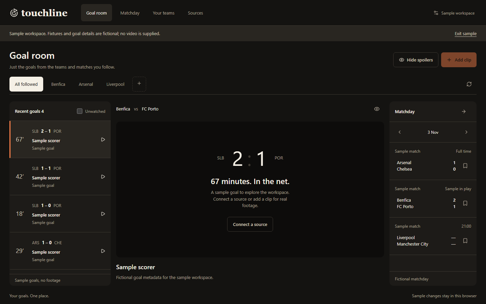

# Touchline

A personal goal room: follow football clubs and individual fixtures, then watch their goal clips together. Built with .NET 10, React, TypeScript and SQLite.



## Run locally

Requirements: .NET 10 SDK, Node.js 22.14+ and npm.

```powershell
./scripts/start.ps1
```

Open `http://127.0.0.1:5195`. The script installs frontend dependencies when needed, builds the frontend and serves the complete app from ASP.NET Core. If the SDK is outside PATH, pass `-DotNet /path/to/dotnet` or set `DOTNET_ROOT`.

For development, run `dotnet run --project src/Touchline.Api` and `npm --prefix web run dev` in separate terminals. The Vite UI is at `http://127.0.0.1:5194` and proxies `/api` to the .NET host.

## What works without keys

- Follow 24 supported clubs across six countries and persist your choices in SQLite.
- Add a Reddit goal post manually, with an optional Streamable or YouTube clip URL.
- Watch supported embeds at their original host, open the source thread, and mark goals watched.
- Hide scores and scorers until you reveal a goal.
- Explore fictional match and goal metadata using `?sample=true`. Sample mode contains **no football footage**, makes no external provider calls and stores its preferences separately in the browser.

Automatic fixtures and automatic Reddit goal discovery require your own provider access. Missing keys produce connection instructions, never invented live results. This version has been tested with controlled provider responses; real provider access has not been verified with personal credentials.

## Connect fixtures

Register at [football-data.org](https://www.football-data.org/client/register). From this project directory, configure the backend with .NET user secrets:

```powershell
dotnet user-secrets set 'FootballData:Token' '<your-key>' --project src/Touchline.Api
```

Restart the backend, then open Sources. Free-plan scores are delayed, and available competitions depend on the plan. The server makes a shared match-window request, cached for two minutes. There is no claim of instant livescores.

## Connect Reddit only if your app is approved

A Reddit login is not proof of Data API approval. Reddit announced that new public API access requests stopped on October 31, 2026, and remaining public API access ends in March 2027. Verify your existing app's access before enabling this integration. [Official announcement](https://www.reddit.com/r/redditdev/comments/1wubcvf/moving_data_api_apps_to_the_developer_platform/).

For an already approved confidential app supporting application-only OAuth:

```powershell
dotnet user-secrets set 'Reddit:ClientId' '<approved-client-id>' --project src/Touchline.Api
dotnet user-secrets set 'Reddit:ClientSecret' '<client-secret>' --project src/Touchline.Api
dotnet user-secrets set 'Reddit:UserAgent' 'Touchline/0.1 by /u/your-account' --project src/Touchline.Api
dotnet user-secrets set 'Reddit:Enabled' 'true' --project src/Touchline.Api
```

Alternatively, set `Reddit:AccessToken` to an existing approved OAuth token. Such tokens expire; replace it when the provider refuses access. The client-credentials flow refreshes its application token automatically. Restart after settings change. Environment variables use double underscores, such as `FootballData__Token` and `Reddit__Enabled`.

Keys remain on the server and are never returned to the browser. No credential form writes secrets to source files. Do not commit keys or copy them into a chat.

The Reddit reader scans up to 300 recent r/soccer posts, stopping after 48 hours. It does not guarantee every goal will be found. It refreshes at most every two minutes, backs off failures, ignores removed/NSFW posts, excludes misses, highlights and disallowed goals, and uses complete team aliases rather than substring guesses. A goal needs two supported teams, a score and a minute. Ambiguous/unrecognized titles are skipped. Alternate posts with the same teams, UTC posting date, score and minute are grouped conservatively.

Reddit posts are held in the short-lived memory cache, not archived in SQLite. Manually added links are explicitly stored locally. No scraping workaround, private API, clip downloading or rehosting is used. Other video hosts and removed/blocked embeds open in the original thread. Reddit-hosted DASH video is not combined or downloaded for inline playback.

## Scope and storage

This is a **single-user local application**, bound to loopback by default. Its SQLite file is `src/Touchline.Api/data/touchline.db` when launched normally. Set `DatabasePath` to choose another file. Favourites and manually added clips persist there. Sample preferences use the separate `touchline.sample` browser-storage key.

It has no multi-user login or public deployment configuration. Keep it local; an internet service would need accounts, per-user storage and an approved long-term clip provider. The provider boundary is separate from the UI so a supported source can replace Reddit later.

The layout fills the viewport. Longer lists scroll inside keyboard-focusable panels. On phones, selecting a goal opens its player with a Back to goals action. Matchday remains available from the main navigation. Very short landscape windows permit workspace scrolling.

## Checks

```powershell
dotnet test tests/Touchline.Tests
npm --prefix web test
npm --prefix web run build
node scripts/verify-browser.mjs
```

The browser check uses the installed Playwright and axe dependencies from the sibling Relay workspace. It covers 320×568 through 1440×900, favourites, fixture follows, spoilers, reload persistence and accessibility. Set `TOUCHLINE_URL` to choose a host. Set `TOUCHLINE_ALLOW_WRITES=1` to include the manual-import test, which writes and removes a test clip; use a disposable database for this optional check. The default browser run does not write real preferences or clips. The iframe test intercepts the clip host and never presents a fabricated video as real footage.

Provider and API tests use temporary SQLite databases and mocked HTTP responses. They cover goal matching, URL allowlists, duplicate grouping, error backoff, API validation, persistence and cross-site write rejection.

Sources: [football-data match documentation](https://docs.football-data.org/general/v4/match.html), [Reddit OAuth documentation](https://github.com/reddit-archive/reddit/wiki/OAuth2).
