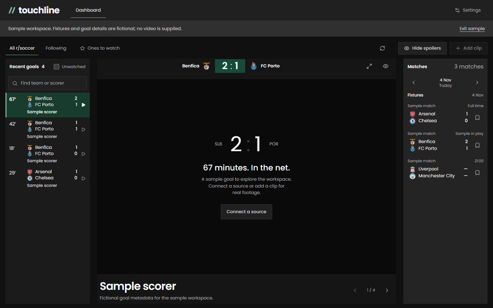

# Touchline: a focused football goal hub

Touchline presents the available r/soccer goal feed beside a persistent video player. The core action is opening a goal; there is no club catalogue or fixture setup to complete first.

The .NET 10 API validates and groups posts, resolves approved media metadata, caches upstream requests, persists viewing preferences in SQLite, and streams updates through server-sent events. React and TypeScript handle responsive browsing and player state. Existing provider, parsing and API compatibility remain available behind the simplified interface.

Search recognises club aliases and accents without leaking hidden scorers. Filtering and live updates preserve the playing clip. Selecting the same goal does not restart playback. Match scores and a chronological strip of goals from the same fixture replace global navigation arrows; spoiler mode avoids revealing the match’s later score. Seen state updates optimistically; spoiler-hidden clips wait for reveal. The phone player unloads when returning to the feed. Media recovery tries attributed alternatives and offers source links when hosts restrict playback.

The interface keeps one header, an aligned goal list and the footage. Unwatched goals have muted orange cues, watched rows recede, and the active clip uses deep green. All available goal categories share one feed. Seen clips move into a collapsed accordion inside the list; the top bar contains just the logo mark, search and utility controls. The compact connection panel distinguishes public Reddit feeds from OAuth and exposes individual fetch times. Crest aliases and parent-club matching recover images across provider naming differences. Goals outside the initial club metadata catalogue still appear. Legacy favourite or match URLs cannot narrow the results.

Verification covers responsive layouts, accessibility, search, spoiler privacy, seen persistence, mobile media unloading, unchanged player instances, long-list navigation and playback failure recovery. Sample fixtures and goal metadata contain no supplied footage and are never presented as live football.

The default application is local and single-user. The optional Pages build uses a separately hosted, read-only API and browser-local viewing preferences for each visitor. Clip availability depends on the original hosts and provider access. The Reddit RSS retirement described in the README remains a source limitation; the provider boundary allows a supported replacement without rebuilding the viewing interface.

The discovery pipeline merges paginated Reddit posts into a persistent 48-hour SQLite collection. A hosted collector runs independently of browser sessions. Publication-based expiry applies even during upstream failures, and a browser deadline removes stale clips while offline. RSS backfill obeys Retry-After and preserves partial discoveries; complete historical coverage remains dependent on Reddit access and listing availability.
